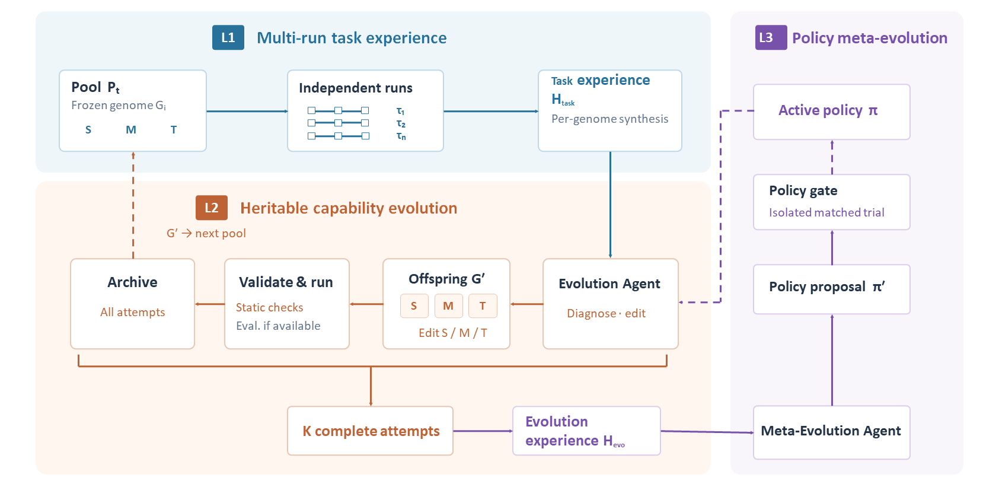

[简体中文](README.md) | [English](README.en.md)

# HEAS — Hierarchical Evolutionary Agent System

**Evolve agents—and evolve the strategy that evolves them.**  
*Genetic-algorithm-inspired, evidence-guided evolution of agent capabilities and evolution strategies.*

HEAS is a research framework for studying how a **single task agent can evolve through genetic-algorithm-inspired mechanisms, and how its evolutionary strategy can itself improve**. One Task Agent can execute many tasks and accumulate multiple trajectories. HEAS uses that evidence to evolve compositional capabilities instead of repeatedly rewriting the entire agent as a black box.

## Core Idea: Genetic-Algorithm-Inspired Capability Evolution

HEAS adopts the evolutionary logic of **individuals, selection, genetic operators, evaluation, and retention** without mechanically imposing a fixed-length chromosome or fixed operator probabilities on an LLM-based agent. Its heritable capabilities are represented as an inspectable, compositional, versioned **TaskGenome**; the strategy used to evolve that genome is modeled separately as **EvolutionPolicy**.

| Genetic-algorithm concept | HEAS mechanism |
|---|---|
| Individual / genotype | **TaskGenome = (Skill, Memory, Tools)** |
| Candidate population and lineage | Genome candidates, parent relations, versions, and evolution records |
| Fitness signal | Objective outcomes supplied by the external task environment and evaluator |
| Selection | Choose parents using task experience and evaluation evidence |
| Recombination / inheritance | Selectively inherit and combine Skill, Memory, and Tools |
| Mutation and innovation | Modify existing capabilities or create Skills, Memory entries, and tool configurations |
| Pruning | Remove redundant, ineffective, or unsuitable capability components |
| Generational retention | Promote candidates only under comparable evaluation conditions |
| Meta-level evolution | Improve **EvolutionPolicy** from evolution history, then independently evaluate the new policy |

**The key distinction:** HEAS evolves a structured capability genome—not an opaque monolithic prompt or a fixed workflow. Genetic operators propose candidate changes; task execution and external evaluation determine whether those changes should be retained.

## Three-Level Architecture and Evolution Loop

1. **Task Agent — accumulate task experience.** A fixed Genome version executes multiple tasks, producing `Trace` and `RunReflection` records that feed a cross-task `TaskExperienceSummary`. It captures recurring failures, useful patterns, and capability gaps. The Task Agent may reflect on execution, but does not directly rewrite its heritable Genome.
2. **Evolution Agent — evolve the capability genome.** Using task experience and external evaluation, it selects parents and applies inheritance, recombination, mutation, innovation, or pruning to Skill, Memory, and Tools. Each offspring has its own version and lineage and must be executed and evaluated.
3. **Meta-Evolution Agent — evolve the evolution strategy.** It analyzes multiple `EvolutionAttempt` records and outcomes, proposes a new `EvolutionPolicy`, and compares old and new policies in independent trials with matched initial conditions, tasks, and budgets.

```text
Multi-task execution
        ↓
Trace + RunReflection
        ↓
TaskExperienceSummary
        ↓
Parent selection → Inheritance / Recombination / Mutation / Innovation / Pruning
        ↓
Offspring TaskGenome → Execution → External Evaluation → Candidate Retention
        ↓
EvolutionExperienceSummary
        ↓
Meta-Evolution: propose and validate a new EvolutionPolicy
        └──────────────────────────────────────→ Next evolution cycle
```

HEAS has **exactly three fixed levels**; it is not an infinitely recursive self-improvement system. The Meta-Evolution Agent does not recursively modify itself. The Agent Loop, model weights, objective evaluation rules, and safety boundaries are outside the evolvable surface.

## Research Design Highlights

- **Compositional genome evolution.** Skill, Memory, and Tools can be inherited, recombined, mutated, or pruned separately, with version differences and lineage retained.
- **Evidence across trajectories.** Evolution is not decided from a single successful run or model self-assessment. The task level aggregates multiple execution traces; the evolution level aggregates multiple evolutionary attempts.
- **From evolving an agent to evolving the method of evolution.** TaskGenome and EvolutionPolicy are distinct evolvable objects, managed by the Evolution Agent and Meta-Evolution Agent respectively.
- **Evaluation-governed candidate selection.** Structural validity, successful execution, and performance improvement are distinct states. Candidate promotion and policy adoption require independent, comparable evidence.
- **Task-agnostic boundaries.** Tasks are integrated through `TaskProvider`, `TaskEnvironment`, and `TaskEvaluator`; benchmark adapters remain separate from the core evolutionary mechanism.

## Comparison with Representative Related Work

The table summarizes the main research objects and mechanisms described in the cited papers. It is intended to position HEAS, not to serve as a comprehensive survey or a performance ranking under matched experimental conditions.

| Method / paper | Main object and mechanism | HEAS design emphasis |
|---|---|---|
| [Self-Refine (2023)](https://arxiv.org/abs/2303.17651) | Iteratively revises a task output using self-generated feedback | HEAS focuses on persistent capability components evolved across tasks, rather than only refining an individual output |
| [EvoAgent (NAACL 2025)](https://aclanthology.org/2025.naacl-long.315/) | Uses selection, crossover, and mutation to generate multi-agent systems | HEAS focuses on compositional evolution of one Task Agent’s Skill / Memory / Tools, and separately models improvement of the evolution strategy |
| [AFlow (ICLR 2025)](https://proceedings.iclr.cc/paper_files/paper/2025/hash/5492ecbce4439401798dcd2c90be94cd-Abstract-Conference.html) | Searches and optimizes code-represented agent workflows using execution feedback | HEAS does not treat Workflow as the core evolving object of TaskGenome; it evolves capability components |
| [Darwin Gödel Machine (2025)](https://arxiv.org/abs/2505.22954) | Modifies and evaluates agent code while maintaining an archive for open-ended self-improvement | HEAS deliberately uses a bounded, fixed three-level architecture rather than recursive framework self-modification |
| [MemEvolve (ICML 2026)](https://proceedings.mlr.press/v306/zhang26fa.html) | Jointly evolves agent experiential knowledge and memory-system architecture | HEAS includes Memory in a compositional TaskGenome and separately models EvolutionPolicy as a second evolvable object |
| [HyperAgents (2026)](https://arxiv.org/abs/2603.19461) | Allows the meta-improvement mechanism itself to be modified for self-referential recursive improvement | HEAS explicitly chooses fixed three-level hierarchy: it improves EvolutionPolicy without recursively modifying the Meta-Evolution Agent itself |
| **HEAS (current design)** | **Evolves TaskGenome and improves EvolutionPolicy from evolution experience** | **Integrates component-level genetic operators, cross-task evidence, policy meta-evolution, and independent evaluation in one fixed hierarchy** |

HEAS does not claim to be the first system to use genetic algorithms or meta-evolution. Its research focus is the integration of **compositional capability genomes, evidence aggregated across multiple executions, evolution-strategy improvement, and independent validation** in a task-agnostic hierarchical framework. These are design claims; their empirical value remains to be tested through ablations and benchmark evaluation.

## Installation and Quick Start

Requires Python `>=3.11,<3.12`.

```bash
git clone https://github.com/yangkunpeng-coder/HEAS.git
cd HEAS
python -m pip install -e .
```

For additional dependencies used by benchmark adapters:

```bash
python -m pip install -e ".[benchmarks]"
```

Windows CMD example:

```cmd
copy configs\application.example.json configs\application.local.json
set "HEAS_API_KEY=YOUR_API_KEY"
python -m heas --help
```

Edit the model name, `base_url`, and `api_key_env` in `configs/application.local.json`. Initialize a Task Agent:

```cmd
python -m heas --workspace workspace\research init --skill templates\SKILL.md --memory templates\MEMORY.md
```

The command returns a `genome_id` and `policy_id`. Running real tasks or evolution experiments additionally requires a trusted Host plugin, task environment, and external evaluator. Install official benchmark runners, datasets, and container environments according to their own instructions. Real model calls may incur charges.

## License

HEAS is released under the [MIT License](LICENSE). Copyright (c) 2026 yangkunpeng-coder.

Third-party papers, benchmarks, datasets, and dependencies remain subject to their respective licenses and terms.
